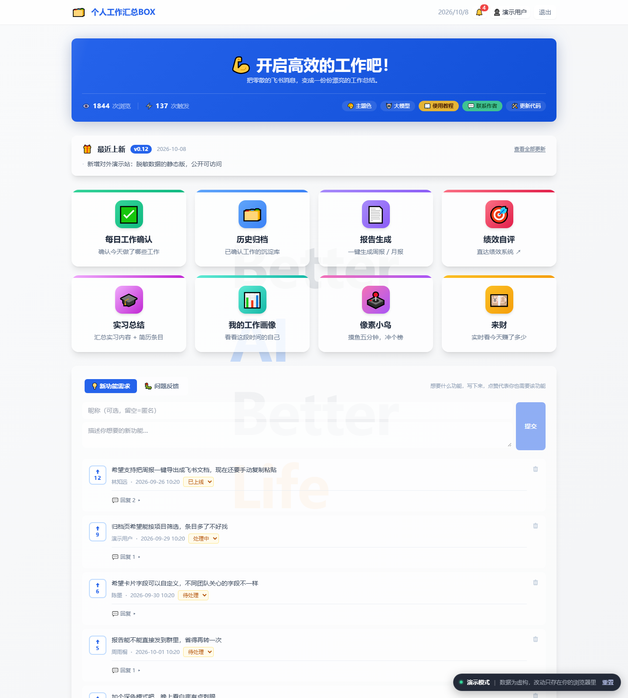
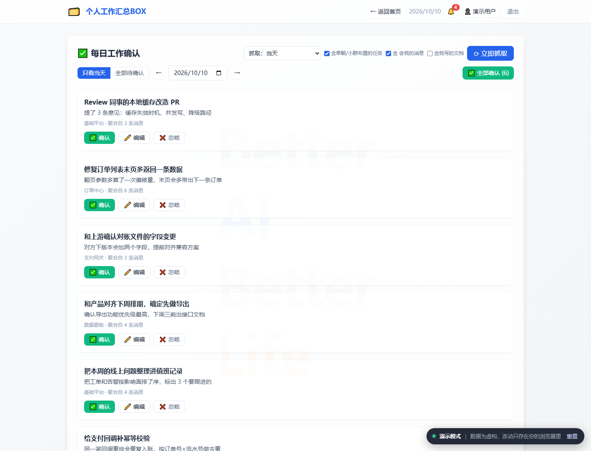

# 个人工作汇总 BOX · 在线演示

把一个只在内网跑的工具，做成**外网可以直接打开、可以点、可以操作**的静态演示站。

**在线演示：<https://ziqi0521.github.io/work-summary-box-demo/>**

---

## 这是什么

一个把零散的飞书消息凝练成工作周报 / 月报的小工具：抓取指定日期范围内的聊天记录，
交给大模型抽成一张张「今天做了什么」的工作卡片，人工确认 / 编辑 / 去重后沉淀成归档，
再一键生成周报、月报，甚至简历条目。

线上版跑在公司内网（FastAPI + SQLite + 飞书开放平台 + 大模型网关）。**这个仓库是它的
对外演示版**：前端一行没改，但所有后端接口都由一层 shim 接管，数据是编造的。

## 演示站做了什么

| 页面 | 说明 |
| --- | --- |
| 每日工作确认 | 待确认卡片、逐张确认 / 编辑 / 忽略、一键全确认、模拟抓取 |
| 历史归档 | 按月归组、搜索、补卡、一键去重（可预览再合并） |
| 报告生成 | 周报 / 月报，三种写法，**流式逐字上屏**，可对话改稿 |
| 实习总结 | 从工作条目凝练实习总结 + 简历条目 |
| 我的工作画像 | 投入方向 Top5、每月记录量、最忙的一天 |
| 像素小鸟 | 可玩的 2048 式小游戏，带排行榜 |
| 反馈墙 | 需求 / 问题反馈、点赞、回复、状态流转 |




站上还放了两篇文档（内容取自线上 wiki，脱敏后渲染成静态页）：

- [使用教程](tutorial.html) —— 从登录、绑定大模型 Key，到抓取、确认、出周报，一步步走完
- [设计方案](design.html) —— 已上线系统的实际设计：核心流程、技术架构、关键设计决策、风险与应对

## 架构：不改前端，换掉后端

关键约束是**不能为了做演示去改前端源码** —— 否则演示版和线上版就是两份代码，
线上改了演示版不会跟着变，很快就烂掉。

于是做法是：构建时把线上那份 `index.html` 原样搬过来，只在末尾追加两个脚本。

```
线上 index.html  ──┐
                  ├─► build_site.py ─► index.html（演示站）
src/demo_data.js ─┤      （只做 5 处改写 + 末尾注入）
src/shim.js ──────┘
```

**为什么一层 shim 就够了**：前端约 40 个请求全部汇集到 `api()` 里的那一个
`fetch(url, opts)`，所以在 `window.fetch` 上装一张路由表就能全覆盖。
唯一绕开 fetch 的是 `EventSource`（抓取进度、报告流式生成、改稿、去重扫描四条流），
单独接管 `window.EventSource`，用 `setTimeout` 回放预设的事件序列即可。

演示站因此能做到「真的能操作」：确认一张卡片、点个赞、回复一条、生成一篇报告，
状态都写进 `localStorage`，刷新还在；右下角「重置」清掉本地改动回到初始状态。

### 踩到的两个坑

- **Alpine 不能内联在 `<head>`。** 它的 CDN 构建末尾是
  `queueMicrotask(() => Alpine.start())`，而 `start()` 在 `document.body` 还不存在时
  会直接放弃初始化。原本靠 `<script defer>` 撑到 DOM 解析完，**内联脚本不吃 defer** ——
  挪到 `</body>` 前、shim 之后才正常。
- **shim 必须装得比 Alpine 早。** Alpine 一 `start()` 就会跑 `x-init` 里的 `init()`，
  那一刻 `fetch('/api/me')` 必须已经被接管，否则整站停在登录门。

## 目录

```
├─ index.html           构建产物：演示站本体
├─ tutorial.html        构建产物：使用教程
├─ design.html          构建产物：设计方案
├─ src/
│  ├─ demo_data.js      演示数据集（全部编造）
│  ├─ shim.js           假后端：fetch 路由表 + EventSource 回放
│  ├─ banner.html       右下角「演示模式」胶囊 + 重置按钮
│  ├─ alpine.min.js     本地化的 Alpine 3.17.4（不依赖 CDN）
│  ├─ build_site.py     生成 index.html
│  ├─ build_docs.py     读线上 wiki → 脱敏 → 渲染成两个文档页
│  ├─ docs/*.md         脱敏后的文档快照（wiki 不可达时可据此重建页面）
│  ├─ check_public.py   发布前脱敏闸门
│  ├─ test_shim.js      shim 的接口契约测试（75 条断言）
│  └─ shoot.py          无头 Chrome 截图
└─ assets/              截图
```

## 本地跑

```bash
python src/build_site.py          # 生成 index.html
python src/check_public.py        # 脱敏闸门，必须绿
node   src/test_shim.js           # shim 契约测试
python src/shoot.py               # 重新截图
python -m http.server 8080        # 然后开 http://localhost:8080
```

`build_docs.py` 要现读线上 wiki（需要飞书授权），跑一次会重写 `tutorial.html` /
`design.html` 和 `src/docs/*.md`；改文档内容改的是 wiki，不是这里。

`build_site.py` 的每一条改写都要求**恰好命中一次**，命中数不对就退出 —— 上游
`index.html` 一改，这里立刻炸掉，而不是悄悄产出一个半坏的页面。

## 关于数据

**演示数据全部是编造的**，不含任何真实姓名、群名、项目名或凭证。

`check_public.py` 是发布前的闸门：它从线上库**只读**拉出真实姓名、群名、项目名、
open_id（只在内存里，不落盘、不打印原文），反过来逐行扫仓库里每一个要公开的文本文件，
再叠一份内网域名 / 内网 IP / 凭证形状的黑名单。命中就失败并列出位置。

它带自检：拿一条真实词条当探针走一遍匹配路径，确认「能命中、且干净文本不误报」——
不然黑名单读空了，闸门照样打印「全部通过」，比没有闸门更危险。

## 和线上版的差异

- 数据：编造的演示数据，不是真实数据
- 后端：`window.fetch` / `window.EventSource` 上的 shim，不发任何真实网络请求
- 链接：指向公司内部系统的入口（使用教程、绩效系统）已改为站内页面或占位地址
- 登录：演示站恒为已登录状态，没有真的飞书 OAuth
